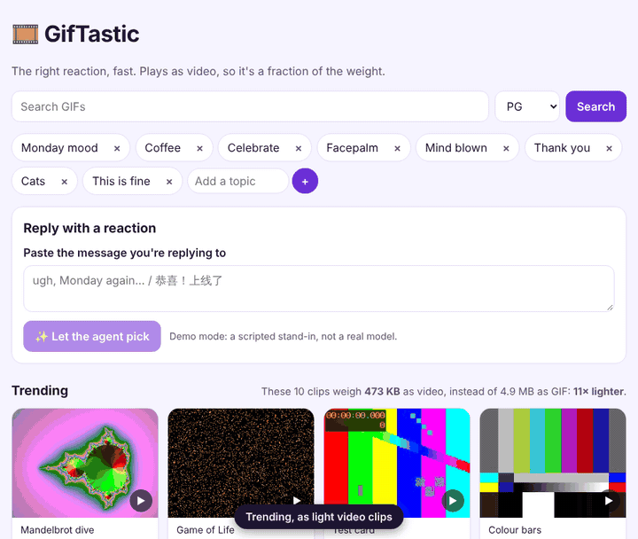
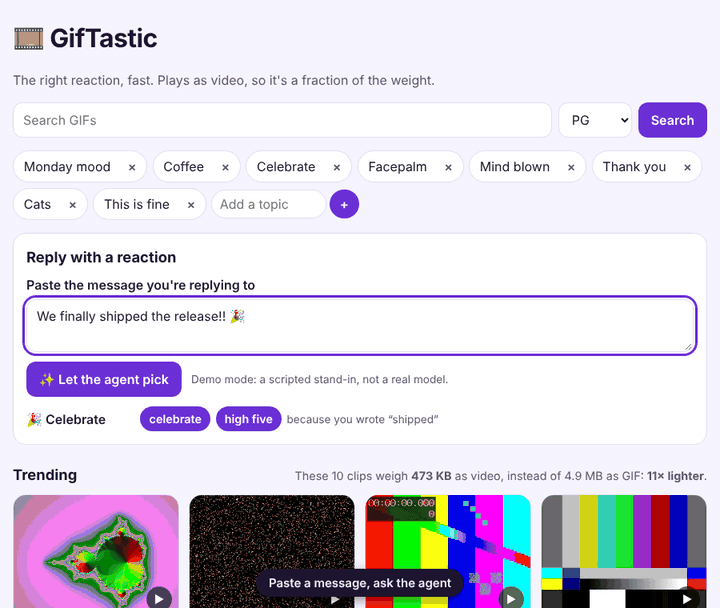
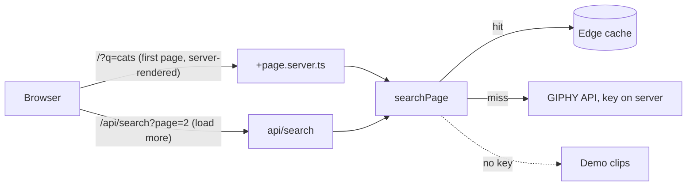

# 🎞️ GifTastic

Find the right reaction fast. Search, browse topics, paste the message you're replying to for instant ideas, or let a **vision agent** search, look at the clips and pick for you. Clips play as **video**, about ten times lighter than GIF.



> Originally a 2019 bootcamp assignment (jQuery and the GIPHY API), rebuilt in 2026.

## What this project is for

The original taught one thing: **call a third-party API from a web page**. This version teaches how to do that well:

1. **Keep the key on the server.** The 2019 page shipped its API key to every visitor. Here the browser only talks to this site; a server route calls GIPHY with a secret.
2. **Respect the API's limits.** Results are cached at the edge for 10 minutes, keyed by the normalised query, so "Cats", "cats " and "CATS" cost one call.
3. **Media is the real performance problem.** A `.gif` is a 1987 image format pretending to be video. The page plays MP4 renditions instead and shows you the difference it makes.
4. **Motion is a choice.** Clips stay still until you hover, focus or tap them, and never preview on their own if your system asks for reduced motion.

## The GIF agent



Paste the message you're answering and press **Let the agent pick**. A multimodal model works in a small loop, and the page streams every step as it happens (Server-Sent Events):

1. **search_gifs**: it chooses its own queries ("we finally shipped" → "celebrate", "high five").
2. **look_at**: it is shown one frame of each promising clip, as an image. It judges what the clip _shows_, not just its title.
3. **choose**: one to three picks, each with a reason and **alt text**, so your reply is accessible too.

Every tool call is validated in [`src/lib/server/agent/agent.ts`](src/lib/server/agent/agent.ts): it can only look at ids a search returned, only choose clips it has looked at, and has budgets (6 steps, 3 searches, 12 frames). A confused model gets told what was wrong; a run that runs out of steps still returns the closest matches. The message and GIF titles are treated as data, never as instructions.

**Which AI.** This project uses a different model family from the others, for a different job: **vision plus tool calling**. The adapters in [`src/lib/server/agent/model.ts`](src/lib/server/agent/model.ts) speak:

| `AGENT_PROVIDER` | Covers                                                                                                                                                  |
| ---------------- | ------------------------------------------------------------------------------------------------------------------------------------------------------- |
| `gemini`         | Google Gemini's native API (function calling + inline images). Replays the model's own turns verbatim, which Gemini 3 needs for its thought signatures. |
| `openai`         | Any OpenAI-compatible API with tools and images: OpenAI, or **Ollama** with a vision model (`qwen2.5vl`, `llava`…)                                      |
| `demo`           | A scripted stand-in with the same protocol, used by the tests and the GIF above, and labelled "not a real model" in the UI                              |

Set `AGENT_PROVIDER`, `AGENT_MODEL` (any model with tools and image input) and the secret `AGENT_API_KEY`; for `openai` also `AGENT_BASE_URL`. Without them the button simply isn't shown. A finished run is cached for a day per message, so asking twice costs nothing.

**Reply with a reaction (no AI).** As you type, a small lexicon in [`src/lib/reactions.ts`](src/lib/reactions.ts) reads the mood in English and Chinese and suggests searches, saying **which words** it reacted to. It is instant, private and works offline.


## Run it

```sh
bun install
bun run dev         # http://localhost:5173 with the bundled demo clips
```

Add `GIPHY_API_KEY` (and the `AGENT_*` values) to `.dev.vars` (see [`.dev.vars.example`](.dev.vars.example)) to search the real catalogue. Without a key, the app serves 12 demo clips generated by [`scripts/make-demo-clips.mjs`](scripts/make-demo-clips.mjs), so it always works, including in tests.

| Command                               | What it does                                                                                                                                       |
| ------------------------------------- | -------------------------------------------------------------------------------------------------------------------------------------------------- |
| `bun run test`                        | Unit tests with Bun's built-in runner: validation, GIPHY mapping, paging, caching, reactions, the agent loop and both model adapters               |
| `bun run e2e`                         | Playwright on the production build in the Workers runtime: desktop and phone, JavaScript on and off, reduced motion, the agent, axe in both themes |
| `bun run lint`                        | oxlint and oxfmt (Rust-based; lint and format the whole repo, `.svelte` files included, in well under a second)                                    |
| `bun run typecheck`                   | `svelte-check`, including Svelte's built-in accessibility warnings (none allowed)                                                                  |
| `bun run validate`                    | Everything, in order                                                                                                                               |
| `bun run demo-clips` / `bun run gifs` | Regenerate the demo clips / the GIFs in this README (need `ffmpeg`)                                                                                |

## How it works



Read it in this order:

| File                                                             | What to learn from it                                                                                                                                                                     |
| ---------------------------------------------------------------- | ----------------------------------------------------------------------------------------------------------------------------------------------------------------------------------------- |
| [`src/lib/gif.ts`](src/lib/gif.ts)                               | One `Gif` shape for both sources, and `parseSearch`: untrusted query strings become a valid search, never an error.                                                                       |
| [`src/lib/server/sources.ts`](src/lib/server/sources.ts)         | A `GifSource` interface with two implementations. The GIPHY one builds its URL with `URLSearchParams`, which fixes the 2019 bug where a `&` in a topic broke the request.                 |
| [`src/lib/server/search.ts`](src/lib/server/search.ts)           | The cache: a normalised key, a TTL, and the Workers Cache API behind a tiny interface so it can be tested with a `Map`.                                                                   |
| [`src/routes/+page.server.ts`](src/routes/+page.server.ts)       | Server rendering: `?q=cats&page=3` renders 30 results, so links are shareable and the page works without JavaScript.                                                                      |
| [`src/routes/+page.svelte`](src/routes/+page.svelte)             | Svelte 5 runes: `$state`, `$derived`, `$props`. "Load more" fetches one page and appends it, then updates the address so a reload shows the same thing.                                   |
| [`src/lib/GifCard.svelte`](src/lib/GifCard.svelte)               | The clip: a `<video>` with a still poster and `preload="none"` (nothing downloads until you look), a fixed 4:3 tile so the grid never jumps, and browser controls when JavaScript is off. |
| [`src/lib/preferences.svelte.ts`](src/lib/preferences.svelte.ts) | Topics and favourites as a runes class saved to `localStorage`. No accounts, no database.                                                                                                 |

### Design decisions

- **SvelteKit 3 and Svelte 5**, a different framework from the other projects in this set: it compiles components away, so the page ships about 35 KB of gzipped JavaScript. Configuration lives in `vite.config.ts`, `$lib` is now the `#lib` subpath import, and Cloudflare bindings come from `cloudflare:workers`.
- **A different toolchain on purpose.** Bun installs packages, runs scripts and runs the unit tests (instead of pnpm and Vitest); oxlint and oxfmt lint and format (instead of Biome), and unlike Biome they understand `.svelte` files. Node still runs Vite and Playwright, which is the boring, reliable part.
- **Plain scoped CSS** in each component instead of a utility framework, to show Svelte's scoping.
- **A grid in reading order.** CSS-columns "masonry" fills each column top to bottom, putting the second-best result under the first; the grid keeps visual, keyboard and screen-reader order the same.
- **A strict CSP with nonces.** SvelteKit adds a per-request nonce to its own inline script, so `script-src` needs no `unsafe-inline`. Media is allowed only from this site and `*.giphy.com`.
- **Demo clips are measured, not guessed.** The generator renders each clip as MP4 and as GIF, records both sizes, then deletes the GIF. The bytes meter uses those real numbers (GIPHY reports both sizes for real results).

## Deploy

```sh
bunx wrangler login
bunx wrangler secret put GIPHY_API_KEY     # optional; without it the demo clips are served
bunx wrangler secret put AGENT_API_KEY     # optional, with AGENT_PROVIDER and AGENT_MODEL
bun run cf:deploy
```

With **Workers Builds** (it detects `bun.lock` and installs with Bun): build command `bun run build`, deploy command `bunx wrangler deploy`, and the default `npx wrangler preview` for other branches (the `previews` block is already in [`wrangler.jsonc`](wrangler.jsonc)). The Worker's name is `gif-tastic-dynamic`. Set `GIPHY_API_KEY` (and the `AGENT_*` values) as secrets in the dashboard. If the build command is left empty, `bun install` still builds the app on Workers Builds, through [`scripts/prepare.mjs`](scripts/prepare.mjs).

## Honest limits

- **GIPHY's free key allows about 100 calls an hour.** The edge cache helps, but a busy site needs a production key from GIPHY.
- **The old key is still in git history.** The 2019 version committed a GIPHY key in `assets/javascript/app.js`; revoke it.
- **The agent spends money or quota on every new message.** Results are cached per message, but there is no per-visitor rate limit yet; add a Rate Limiting binding or Turnstile before sharing the link widely.
- **The real agent has not been run against a live model here.** The loop, both adapters' wire formats and the demo agent are tested; the first real run needs a key.
- **The instant suggestions use a word list.** They are fast, private and explainable, but miss sarcasm and anything they have no word for.

## Ideas to extend

- **Make your own:** let the agent caption a clip ("me after the deploy") and render the caption onto the video in the browser with WebCodecs.
- **Share sheet:** use the Web Share API to send a clip straight to a chat app on phones.
- **Offline favourites:** a service worker that keeps your favourite clips available on a plane.

## Credits

© 2019–2026 Paul Xu. Built at the University of Toronto School of Continuing Studies Coding Boot Camp (2019) and rebuilt in 2026. Search results by [GIPHY](https://giphy.com).
